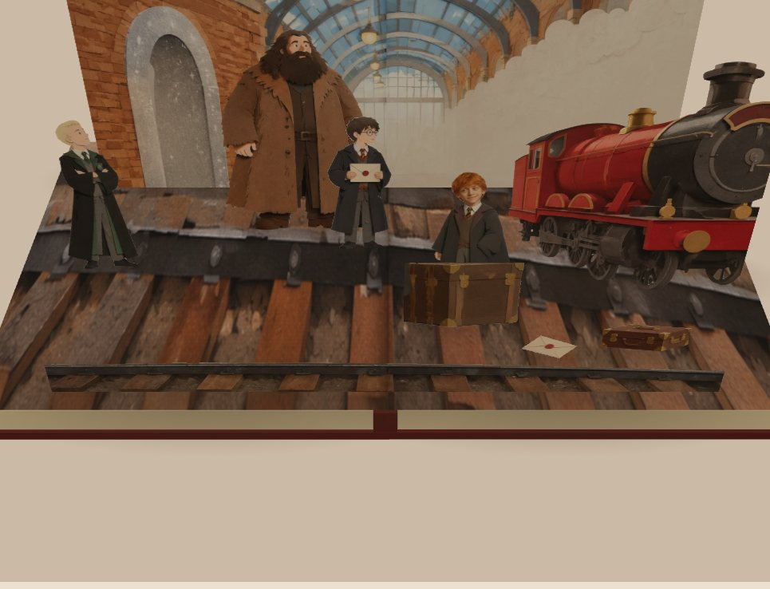

<div align="center">
  <a href="https://neta.art">
    
  </a>

  <h1>Pop-Up Storybook</h1>

  <p><em>Turn a world into a real readable pop-up book: hardcover boards, page blocks, a curling leaf, and cut-paper standees that rise off the page as you turn it.</em></p>

  <p>
    <a href="https://neta.art"></a>
    <a href="SKILL.md"></a>
    <a href="LICENSE"></a>
    <a href="SKILL.md"></a>
  </p>
</div>


<p align="center">
  
</p>
<p align="center"><sub>A spread from this skill: every standee cut from its composition master and standing at its own depth · the scene rises with the page</sub></p>


Build an actual readable Three.js book — hardcover boards, two page blocks, a curling leaf, and paper standees that rise off the page. Dressed for the world it comes from, delivered as a published Web Work with real page turns.

## Highlights

- 🎯 **When to pick it** — The user wants a pop-up book, a paper-cut picture book, or a turnable story book for a world they have. Triggers: 立体书, 纸雕绘本, 翻页立体书, pop-up book, paper storybook.
- 📦 **What you get** — A published Web Work with a real 3D book: one questionnaire (style, chapters, spreads, story, chrome, narration), one composition master per spread, every standee cut out of its master with qwen-image-2.1, each on its own depth, a dedicated titled cover, and world-themed reading chrome. Comes with the same runtime as this skill's `templates/`, so any world can be bound into it.
- 🌍 **Where it runs** — Inside a Neta Studio world, through the skill picker. It reads the world first, then builds.
- 🚫 **Out of scope** — A branching adventure or choose-your-own-adventure game (that is a playable game, not a book); a static PDF or flat illustrated pages; a manufacturing-ready paper-engineering plan.

## How it works

```text
world recon → ONE questionnaire (style, chapters, spreads, story, chrome, narration)
→ storyboard → one composition master per spread → ONE board halt
→ qwen-image-2.1 in-place cut-outs → matte + measure → unique-depth placement → 2D proof
→ world theme → assemble the book → headless QA shots → publish
```

The creator stops the run exactly twice: the questionnaire, and the board halt. Everything after the
board is agent work until the Work is published and verified on its live CDN build.

**The mechanism (what a reader sees).** The book opens on one hinge — the front cover and the left half
of the block turn together up and over the spine, nothing fanning out of the gutter or sliding. The
closed book is on screen at once and textures bind behind it. Every standee rises on one curve driven by
the page angle — no batches, no per-piece delay; left-page pieces turn with their page, and
gutter-spanning pieces are cut at the gutter into two halves. Closing is the same curve backwards.

## Quick start

This is a **Neta Studio skill**, not a Node app. There is no `npm start`.

1. Open a world in [Neta Studio](https://neta.art).
2. Copy this folder to `.agents/skills/popup-storybook/` so `SKILL.md` sits at that root.
3. Reload. Pick **popup-storybook** in the skill picker.

```bash
cp -R popup-storybook path/to/world/.agents/skills/popup-storybook
```

Working on the skill itself:

```bash
node scripts/test-skill.cjs                 # full self-test (13 suites)
node scripts/scaffold.mjs path/to/book-root # schema v3 book + runtime scaffold
```

> [!NOTE]
> Contract, inputs, halts, and acceptance live in [SKILL.md](SKILL.md), with the pipeline details in
> [`references/`](references) and the reusable runtime in [`templates/`](templates). Do not copy
> branded UI, slogans, or third-party assets.

## License

[MIT](LICENSE) · Built for [Neta Studio](https://neta.art).
